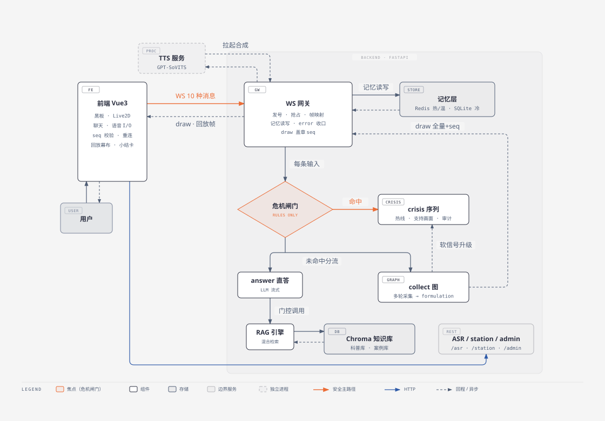
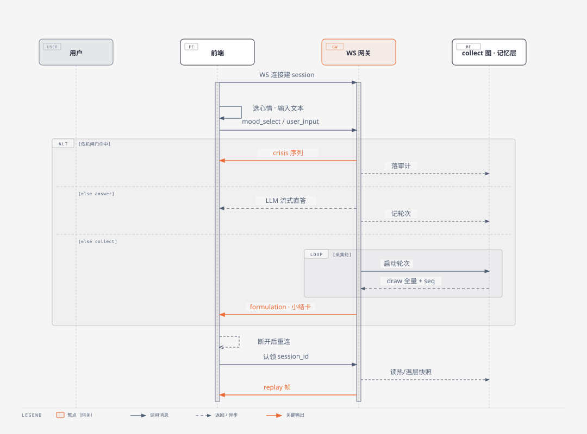

# 心栖阁 · 架构地图

> **职能**：架构地图——模块职责与机制速览，不复制参数。机制与参数请参阅 [architecture-spec.md](docs/architecture/architecture-spec.md)（spec），消息格式请参阅 [ws-contract.md](docs/architecture/ws-contract.md)。
> 按角色深入：后端请参阅 [backend-plan.md](docs/architecture/backend-plan.md) · 前端请参阅 [frontend-plan.md](docs/architecture/frontend-plan.md) · 术语请参阅 [CONTEXT.md](docs/architecture/CONTEXT.md) · 决策背景请参阅 [ARCHITECTURE_PROGRESS.md](docs/architecture/ARCHITECTURE_PROGRESS.md)＋[docs/adr/](docs/adr/)。

## 1. 架构总览

交互图版本：[architecture-overview.html](docs/diagrams/architecture-overview.html)（浏览器打开可缩放查看）。

> 图注：组件与数据流走向以此图为准；消息字段与格式请参阅 [ws-contract](docs/architecture/ws-contract.md)；TTL、提示词等参数以 spec 为准。route 走分层判定：规则速判在前，模糊输入才调 LLM。

## 2. 会话生命周期

交互图版本：[session-lifecycle.html](docs/diagrams/session-lifecycle.html)。

> 图注：交互次序以此图为准；每条消息的字段与格式请参阅 [ws-contract](docs/architecture/ws-contract.md)；危机热线请参阅 spec「危机分支」节，审计范式请参阅 [ws-contract「日志范式（双输出）」节](docs/architecture/ws-contract.md)。

## 3. 模块职责

### 后端（FastAPI + LangGraph）

职责与接口请参阅 [backend-plan「模块职责表」节](docs/architecture/backend-plan.md)。

- **ws 网关**（`backend/app/ws_gateway/gateway.py`）：一条连接承载全流水线。连接建 session_id；每条 user_input 先过危机闸门；发号、抢占、帧映射、error 收口；记忆读写与 draw 帧盖章 seq 由网关统一经手。细节请参阅 [backend-plan「WS 网关」节](docs/architecture/backend-plan.md)
- **危机闸门**（`backend/app/router/gate.py`）：词典＋打分的纯函数，无 LLM/网络调用，确定性。命中即转危机序列并落审计。细节请参阅 [backend-plan「危机与审计」节](docs/architecture/backend-plan.md)
- **分层判定**（`backend/app/router/classifier.py`）：规则先判明显 case，模糊才调 LLM。产出 route / emotion_label / confidence。细节请参阅 [spec「L3 · 智能路由决策器」节](docs/architecture/architecture-spec.md)
- **collect 图**（`backend/app/agents/`）：LangGraph StateGraph。CollectState 挂连接对象，确定性条件边分派，图出口为 CollectEvent 四变体；软信号经 LLM 复核可升级危机序列。细节请参阅 [backend-plan「采集驱动与图内黑板」节](docs/architecture/backend-plan.md)
- **RAG 引擎**（`backend/app/rag/engine.py`）：混合检索走向量（Chroma）＋关键词（BM25）＋重排三路；科普/案例两库由 library 参数区分；重库懒加载。细节请参阅 [backend-plan「模块职责表」rag 行](docs/architecture/backend-plan.md)
- **记忆层**（`backend/app/memory/store.py`）：热/温层 Redis，冷层 SQLite。层介质与生命周期请参阅 [spec「L7 · 数据与知识层」节](docs/architecture/architecture-spec.md)；故障降级不杀回合；重连回放读热/温层快照，冷层只喂 admin 趋势
- **语音**（`backend/app/voice/`）：ASR 两步式转写，ffmpeg 转码在内，转写后即弃；TTS 走 GPT-SoVITS remote（CosyVoice sidecar 为 local 回滚模式）；fillers 是预生成的等待语音
- **station + admin REST**：补给站方案书懒生成与存取（SQLite reports）；admin 管理通道。端点请参阅 [ws-contract「连接与会话」节](docs/architecture/ws-contract.md)

### 前端（Vue3 + Vite + TS）

职责与接口请参阅 [frontend-plan「模块职责表」节](docs/architecture/frontend-plan.md)。

- **ws 客户端**（`frontend/src/ws/`）：连接、重连、seq 校验、消息分发；10 种消息类型定义；session_id 经 localStorage 持久化
- **黑板渲染**（`frontend/src/board/`）：模板声明＋通用渲染器。draw 按 seq 与新字段做增量动画；定制模板只需加一份声明，渲染器零改动
- **Live2D**（`frontend/src/l2d/`）：pixi-live2d-display 封装；情绪标签映射表情参数，口型随播放事件
- **回放与小结卡**：replay 帧驱动；近期回放折叠幕布，隔天小结卡混流。细节请参阅 ADR-005
- **其余**：mood 心情选择器 · audio 音频队列 · chat 聊天与输入 · state 回合状态机 · station 补给站面板

### TTS sidecar（独立进程）

CosyVoice 独立进程（local 回滚模式，`TTS_MODE=local` 时启用），由后端启动时自动拉起并版本握手，退出有序关停；分句流式合成。现行默认 `TTS_MODE=remote`，走 GPT-SoVITS remote HTTP 服务（PCM 流式，round 级打断）。细节请参阅 ADR-002 与 [backend-plan「模块职责表」voice 行](docs/architecture/backend-plan.md)

## 4. 决策记录索引

图表维护规程请参阅 [docs/guides/diagram-maintenance.md](docs/guides/diagram-maintenance.md)。

| ADR | 决策 |
|---|---|
| [001 记忆分层](docs/adr/001-memory-tiering.md) | 热层存近期轮次原话（短 TTL），中长期只留摘要 |
| [002 TTS 流式与 sidecar](docs/adr/002-tts-streaming-and-sidecar-management.md) | 分句流式合成；sidecar 拉起/握手/关停统一管理 |
| [003 采集态门控与防阻塞](docs/adr/003-in-round-gating-and-loop-hygiene.md) | 采集态对路由有否决权；RAG 启动预热 |
| [004 语音两步式](docs/adr/004-asr-transcribe-preview.md) | 转写预览回填，用户确认后按文本发送 |
| [005 回放与小结卡](docs/adr/005-replay-and-digest.md) | replay 帧回放 + 跨天小结卡 + 身份持久化 |
