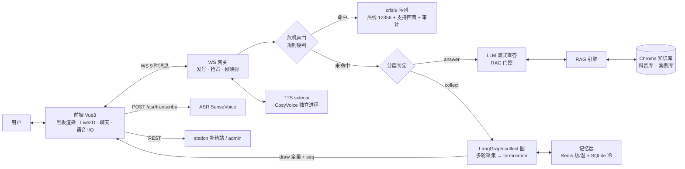

# 心栖阁 · 架构地图

> **职能**:架构地图——模块职责与机制速览,不复制参数。机制与参数单源=docs/architecture/architecture-spec.md(spec)· 消息格式单源=docs/architecture/ws-contract.md。
> 按角色深入:后端=backend-plan · 前端=frontend-plan · 术语=CONTEXT.md · 决策背景=ARCHITECTURE_PROGRESS + docs/adr/

## 1. 架构总览

## 2. 模块职责

### 后端(FastAPI + LangGraph)

职责与接口单源 = `docs/architecture/backend-plan.md` §2。

- **ws 网关**(`backend/app/ws_gateway/gateway.py`):一条连接承载全流水线。连接建 session_id;每条 user_input 先过危机闸门;发号、抢占、帧映射、error 收口。细节 = backend-plan §8
- **危机闸门**(`backend/app/router/gate.py`):词典 + 打分的纯函数,无 LLM/网络调用,确定性。命中即转危机序列并落审计。细节 = backend-plan §6
- **分层判定**(`backend/app/router/classifier.py`):规则先判明显 case,模糊才调 LLM。产出 route / emotion_label / confidence。细节 = spec §4 L3
- **collect 图**(`backend/app/agents/`):LangGraph StateGraph。CollectState 挂连接对象,确定性条件边分派,图出口 = CollectEvent 四变体。细节 = backend-plan §3
- **RAG 引擎**(`backend/app/rag/engine.py`):混合检索 = 向量(Chroma)+ 关键词(BM25)+ 重排;科普/案例两库由 library 参数区分;重库懒加载。细节 = backend-plan §2 rag 行
- **记忆层**(`backend/app/memory/store.py`):热/温层 Redis,冷层 SQLite。层介质与生命周期单源 = spec §4 L7;故障降级不杀回合
- **语音**(`backend/app/voice/`):ASR 两步式转写,ffmpeg 转码在内,转写后即弃;TTS 走 CosyVoice sidecar;fillers = 预生成等待语音
- **station + admin REST**:补给站方案书懒生成与存取(SQLite reports);admin 管理通道。端点单源 = ws-contract §1

### 前端(Vue3 + Vite + TS)

职责与接口单源 = `docs/architecture/frontend-plan.md` §2。

- **ws 客户端**(`frontend/src/ws/`):连接、重连、seq 校验、消息分发;9 种消息类型定义;session_id 经 localStorage 持久化
- **黑板渲染**(`frontend/src/board/`):模板声明 + 通用渲染器。draw 按 seq 与新字段做增量动画;定制模板 = 加一份声明,渲染器零改动
- **Live2D**(`frontend/src/l2d/`):pixi-live2d-display 封装;情绪 JSON 映射表情参数,口型随播放事件
- **回放与小结卡**:replay 帧驱动;近期回放折叠幕布,隔天小结卡混流。细节 = ADR-005
- **其余**:mood 心情选择器 · audio 音频队列 · chat 聊天与输入 · state 回合状态机 · station 补给站面板

### TTS sidecar(独立进程)

CosyVoice 独立进程,后端启动时自动拉起并版本握手,退出有序关停;分句流式合成。细节 = ADR-002

## 3. 关键机制速览

| 机制 | 一句话 | 细节 |
|---|---|---|
| 三路路由 | 每条 user_input 先过危机闸门,再分流 answer / collect | spec §3 |
| 危机判定只在后端 | 前端零危机逻辑;闸门贯穿采集每一轮回答 | spec §8 |
| 黑板一图逐步深化 | 粗稿/精稿同一模板;draw 传全量 formulation + seq,前端 diff | spec §5-§6 |
| 记忆分层 | 热层轮次原话、温层摘要、冷层每日心情;生命周期见 spec | spec §4 L7 · ADR-001 |
| 语音输入单源文本 | 录音 → REST 转写 → 文本框确认 → 按文本发送;音频退出对话流 | ADR-004 |
| replay 重连回放 | 重连认领 session_id 后先推 replay 帧 | ADR-005 · ws-contract §3.6 |

## 4. 决策记录索引

| ADR | 决策 |
|---|---|
| [001 记忆分层](docs/adr/001-memory-tiering.md) | 热层存近期轮次原话(短 TTL),中长期只留摘要 |
| [002 TTS 流式与 sidecar](docs/adr/002-tts-streaming-and-sidecar-management.md) | 分句流式合成;sidecar 拉起/握手/关停统一管理 |
| [003 采集态门控与防阻塞](docs/adr/003-in-round-gating-and-loop-hygiene.md) | 采集态对路由有否决权;RAG 启动预热 |
| [004 语音两步式](docs/adr/004-asr-transcribe-preview.md) | 转写预览回填,用户确认后按文本发送 |
| [005 回放与小结卡](docs/adr/005-replay-and-digest.md) | replay 帧回放 + 跨天小结卡 + 身份持久化 |
